# Technical Malware Analysis Report: Sample 1 (budget-report.exe)

**Analyst:** Carter Pearse  
**Target Sample:** `budget-report.exe`  
**File Size:** 409.50 KB (419,328 bytes)  
**MD5 Hash:** `d7cc6c987c68a88defdab3a59070777e`  
**SHA-256 Hash:** `15cc3cad7aec406a93554c9eaf0bfbcc740bef9d52dbc32bdf559e90f53fee`

---

## 1. Executive Summary

`budget-report.exe` is a **32-bit Win32 executable** compiled with MinGW (GCC) that masquerades as a benign financial document.

Static and dynamic analysis reveals it to be a multi-stage Trojan capable of DLL importing (`WININET.DLL`, `WS2_32.DLL`), user-level registry modification (`RunOnce`), and Command-and-Control (C2) communication with `10.16.100.3`.

On VirusTotal, the sample triggered detections across **56 out of 72 security vendors**, flagged as a malicious Trojan/Reconyc variant.

---

## 2. Static Analysis & File Properties

Initial file fingerprinting and static inspection were performed using VirusTotal file intelligence and PE analysis tools.

- **File Type & Architecture:** PE32 executable (GUI), Intel 80386, compiled for Microsoft Windows.
- **Compiler / Linker:** MinGW (GCC: tdm-1 4.9.2) with GNU linker ID.
- **Detection Ratio:** 56 / 72 security vendors flagged the sample as malicious.

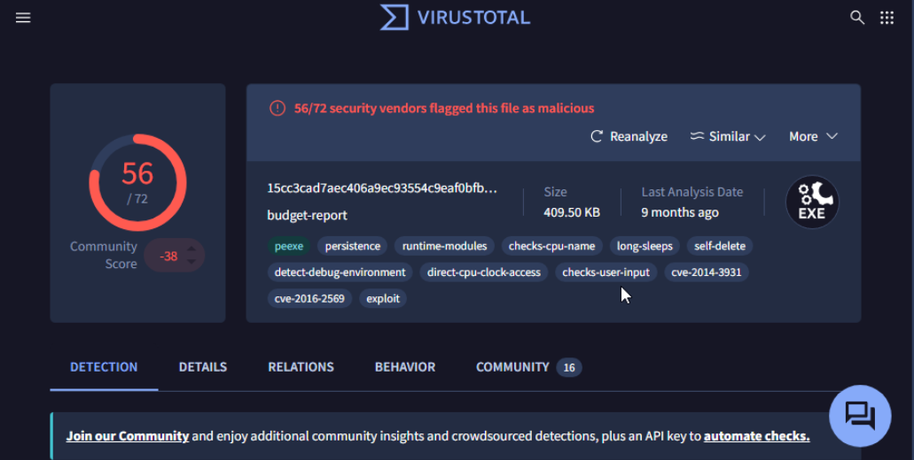

*Figure 1: VirusTotal summary showing 56/72 detections and behavioral capability tags.*

### PE Sections & Entropy Analysis

The executable contains **9 sections** with varying entropy levels. The following section details were identified during static analysis:

| Section Name | Virtual Address | Virtual Size | Raw Size | Entropy | MD5 |
|---|---:|---:|---:|---:|---|
| `.text` | 4096 | 156960 | 157184 | 6.12 | `e4b5c87a7328d602993aa006fcab8977` |
| `.data` | 163840 | 20948 | 20992 | 0.92 | `fec56252066499a1f1132de838023ca1` |
| `.rdata` | 188416 | 15432 | 15872 | 5.36 | `e669a0656d33ad7acd28d2763c00bbad` |
| `.eh_fram` | 204800 | 928 | 1024 | 4.29 | `60632ccf093d8c4855b8da0053234680` |
| `.bss` | 208896 | 373744 | 0 | 0 | `d41d8cd98f00b204e9800998ecf8427e` |

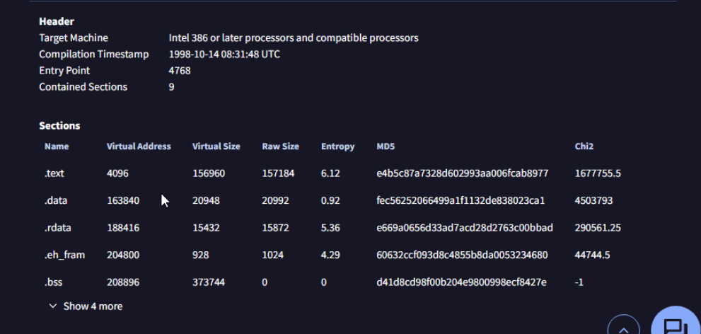

*Figure 2: PE Header and Section breakdown.*

### Imported DLLs & Critical APIs

Static import inspection confirms the presence of networking, process manipulation, and registry interaction libraries.

- **WININET.DLL:** `InternetOpenA`, `InternetOpenUrlA`, `InternetReadFile` — used for web communications.
- **WS2_32.DLL:** Socket communication and C2 networking.
- **ADVAPI32.DLL:** `RegCreateKeyExA`, `RegSetValueExA`, `RegDeleteValueA` — registry interaction and persistence mechanisms.
- **KERNEL32.DLL:** `CreateProcessA`, `CopyFileA`, `CreateThread` — process execution, file operations, and threading.

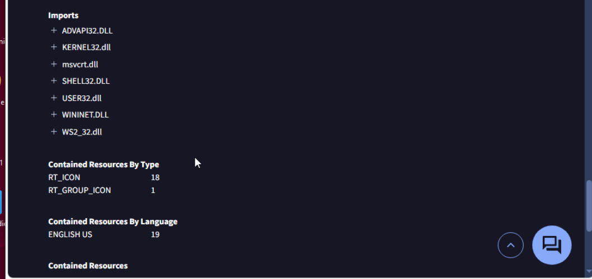

*Figure 3: Imported DLLs including WININET.DLL and WS2_32.DLL.*

---

## 3. Dynamic Analysis Methodology & Setup

To safely observe the runtime behavior of `budget-report.exe`, the sample was executed inside an isolated virtualized analysis lab using Sysinternals Process Monitor (Procmon) and ProcDOT.

### Step 3.1: Configuring Process Monitor Filters

Before running the sample, Process Monitor was configured to capture file system, registry, and network events while filtering out background noise from standard system binaries.

This allowed the analysis to focus on activity associated with the malicious executable.

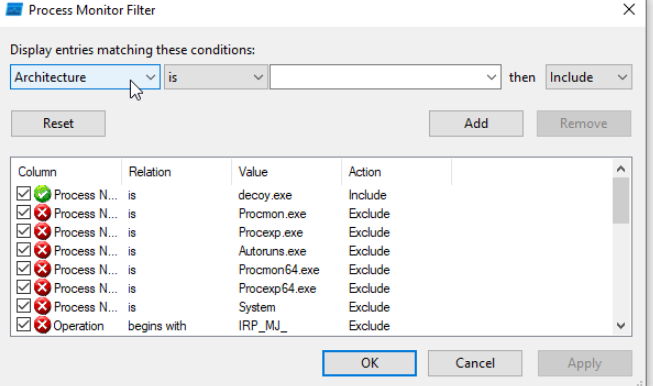

*Figure 4: Configuring Procmon inclusion and exclusion filters.*

### Step 3.2: Executing the Sample and Exporting Logs

The binary `budget-report.exe` was executed from the desktop, and live telemetry was captured using Process Monitor.

The process was identified with **PID 3124**.

The captured events included:

- Process creation and startup activity.
- File system access.
- Registry reads and modifications.
- DLL loading.
- Network-related activity.

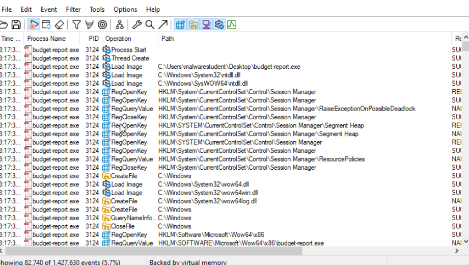

*Figure 5: Procmon capture showing Process Start (PID 3124) and WoW64 context loading.*

The Process Monitor logs were exported for further analysis using ProcDOT.

The data was saved in **CSV format**, allowing ProcDOT to correlate the events and generate a behavioral graph.

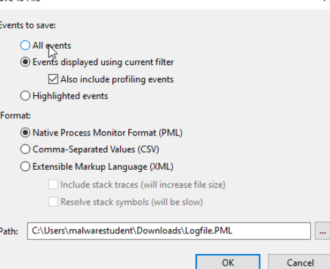

*Figure 6: Exporting Process Monitor log files.*

---

## 4. Behavioral Analysis & ProcDOT Graph Findings

The exported Procmon CSV log was loaded into ProcDOT alongside the process launcher parameter:

`82|3124|budget-report.exe`

This allowed the creation of a visual behavioral graph displaying process relationships, file operations, registry modifications, and network communication.

### Step 4.1: Initializing ProcDOT Sessions

ProcDOT was configured using the exported Process Monitor log.

The target process was selected using its process ID:

- **Process Name:** `budget-report.exe`
- **PID:** `3124`

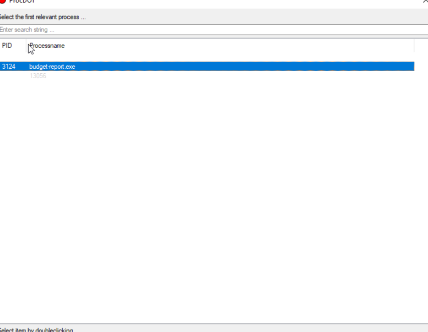

*Figure 7: Selecting target process budget-report.exe (PID 3124).*

### Step 4.2: Refreshing and Rendering the Graph

The monitoring log and launcher PID were verified before generating the graph.

ProcDOT visualized the collected events to identify suspicious activity, including:

- Process relationships.
- File creation and modification.
- Registry changes.
- Network connections.

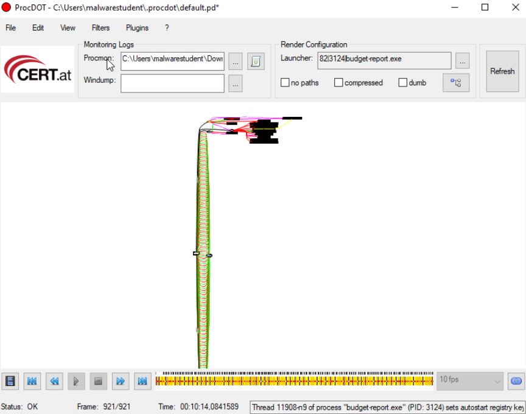

*Figure 8: ProcDOT initialization interface prior to graph rendering.*

### Step 4.3: Identifying Process Spawning & File Dropping

The rendered graph reveals that `budget-report.exe` (PID 3124) drops additional files onto the system.

Two notable files were identified:

**1. Batch Script**

File name: `12648430.bat`

Location:

`AppData\Local\Temp`

This file appears to function as a helper script associated with the malware's execution.

**2. Secondary Executable**

File name: `12648430ctfmon.exe`

Location:

`AppData\Roaming`

The executable uses a name resembling the legitimate Windows process `ctfmon.exe`, potentially allowing it to blend in with normal system activity.

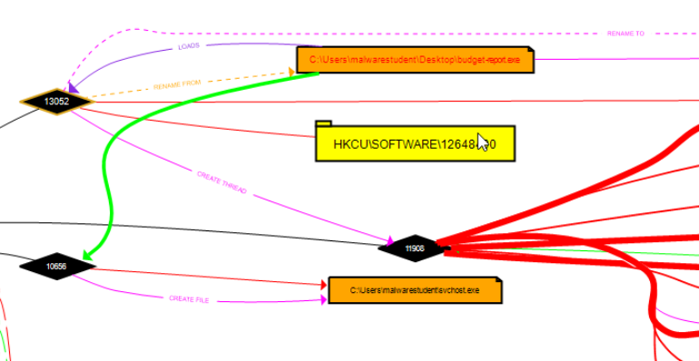

*Figure 9: Process threading and file drop paths in ProcDOT.*

A closer inspection of the graph shows the dropped executable in the user's Roaming AppData directory.

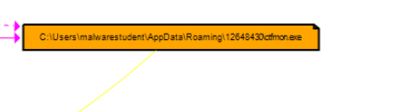

*Figure 10: Close-up of dropped executable masquerading as ctfmon.exe in AppData\Roaming.*

### Step 4.4: Persistence Mechanism (RunOnce)

ProcDOT captures a registry write action establishing user-level persistence through the Windows `RunOnce` registry key.

**Registry Path:**

`HKCU\SOFTWARE\Microsoft\Windows\CurrentVersion\RunOnce\12648430`

The `RunOnce` key allows a specified program to execute automatically at the next user logon.

This mechanism provides the malware with a way to execute again after the initial infection.

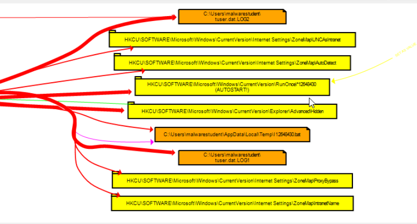

*Figure 11: Registry modification node demonstrating auto-start execution via RunOnce.*

### Step 4.5: Network Activity & C2 Communication

Network telemetry correlation reveals outbound DNS queries and UDP traffic associated with the malicious process.

The primary network destination identified during analysis was:

**IP Address:** `10.16.100.3`

The traffic included UDP domain queries and responses.

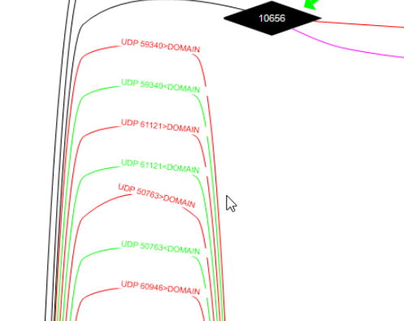

*Figure 12: UDP domain query and response traffic originating from the sample.*

ProcDOT also displayed network connections between the malicious executable and the destination IP address.

This activity is consistent with the sample's reported Command-and-Control (C2) communication behavior.

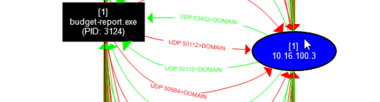

*Figure 13: Outbound connection stream connecting the process to 10.16.100.3.*

---

## 5. Indicators of Compromise (IOCs)

The following indicators were identified during static and dynamic analysis.

| Indicator Type | Indicator Value | Description |
|---|---|---|
| File Name | `budget-report.exe` | Original malicious sample binary |
| File Name | `12648430ctfmon.exe` | Dropped executable masquerading as a system utility in AppData\Roaming |
| File Name | `12648430.bat` | Dropped helper script in AppData\Local\Temp |
| MD5 Hash | `d7cc6c987c68a88defdab3a59070777e` | Original sample MD5 hash |
| SHA-256 Hash | `15cc3cad7aec406a93554c9eaf0bfbcc740bef9d52dbc32bdf559e90f53fee` | Original sample SHA-256 hash |
| Registry Key | `HKCU\SOFTWARE\Microsoft\Windows\CurrentVersion\RunOnce\12648430` | User-level autostart persistence |
| Network IP | `10.16.100.3` | Suspected C2 / lab destination IP |
| Network Protocol | UDP / DNS | Observed outbound network communication |

---

## 6. Conclusion

Through static file profiling, Process Monitor event logging, and ProcDOT behavioral graph visualization, `budget-report.exe` was successfully analyzed.

The investigation identified several malicious behaviors:

- **Persistence:** The sample modifies the Windows `RunOnce` registry key to establish user-level autostart execution.
- **File Dropping:** The malware creates additional files, including a batch script and an executable disguised as `ctfmon.exe`.
- **Network Communication:** The sample generates outbound UDP/DNS traffic associated with `10.16.100.3`.
- **Malware Detection:** VirusTotal identified the executable as malicious across 56 of 72 security vendors.

These findings indicate that `budget-report.exe` is a Trojan capable of establishing persistence, deploying additional payloads, and communicating with a suspected Command-and-Control destination.

The collected indicators and behavioral evidence can support incident response, malware detection, and further reverse engineering.

---

**Analyst:** Carter Pearse  
**Analysis Tools:** VirusTotal, Process Monitor (Procmon), ProcDOT, PE Analysis Tools  
**Sample:** `budget-report.exe`
